# ServiceNow × AWS Integration Hub

**Closed-loop incident management, self-service and CMDB automation between ServiceNow and AWS, built end to end on a free Personal Developer Instance and a single `t3.micro`.**


**Demo video:** _add link here_ &nbsp;·&nbsp; **Author:** Sharon Wainaina &nbsp;·&nbsp; [LinkedIn](https://www.linkedin.com/in/sharon-wainaina-556206395/)

---

## Contents

[Overview](#overview) · [What it does](#what-it-does) · [Architecture](#architecture) · [Walkthrough](#walkthrough) · [Design decisions](#design-decisions) · [Security](#security) · [Troubleshooting log](#troubleshooting-log) · [Verified behaviour](#verified-behaviour) · [Repository layout](#repository-layout) · [Reproduce it](#reproduce-it) · [Limitations and roadmap](#limitations-and-roadmap)

---

## Overview

Most integration demos stop at "send an alert". This project closes the loop in both directions:

- **AWS tells ServiceNow when something is wrong.** A CloudWatch alarm opens (or updates) an incident, without duplicates.
- **ServiceNow tells AWS what to do about it.** Approved catalog requests and a one-click remediation button start, stop and reboot an EC2 instance through a protected API.
- **The CMDB stays truthful.** A sync keeps an EC2 configuration item current, and incidents link to it.

It is a focused lab, not a production system. Where I took a shortcut, it is named in [Limitations and roadmap](#limitations-and-roadmap).

### What this demonstrates

| Area | Skills shown |
|---|---|
| **ServiceNow** | Service Catalog, Workflow Studio flows and custom actions (REST step), approvals, UI Actions, Table API, CMDB (`cmdb_ci_ec2_instance`), integration user and roles |
| **AWS** | CloudWatch alarms, SNS, Lambda, API Gateway (API keys and usage plans), EC2, Secrets Manager, IAM least privilege, EventBridge |
| **Integration engineering** | Idempotent create-or-update, retry-safe writes against a flaky endpoint, state normalisation between two data models, bidirectional auth |
| **Practice** | Systematic troubleshooting, documented trade-offs, secrets handling, cost control |

---

## What it does

| # | Flow | Direction | Result |
|---|---|---|---|
| 1 | **Alarm → incident** | AWS → ServiceNow | An EC2 status-check alarm creates one incident. Repeat firings add a work note to the same incident. Recovery adds a note. The incident is linked to the EC2 CI. |
| 2 | **Self-service** | ServiceNow → AWS | Catalog item **Start/Stop my EC2 sandbox** → approval → API Gateway → Lambda → EC2. The AWS response is written back to the request item. |
| 3 | **Remediation** | ServiceNow → AWS | A **Restart AWS server** button on alarm incidents reboots the instance and logs the AWS response. |
| 4 | **CMDB sync** | AWS → ServiceNow | A Lambda creates or updates the EC2 CI by instance ID, translating AWS states into ServiceNow choices. |

---

## Architecture

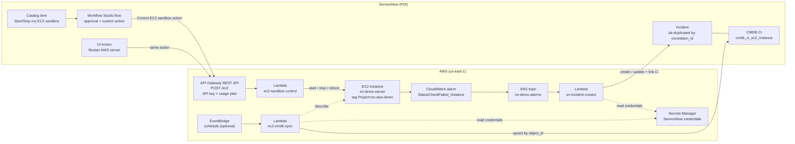

**Self-service sequence**

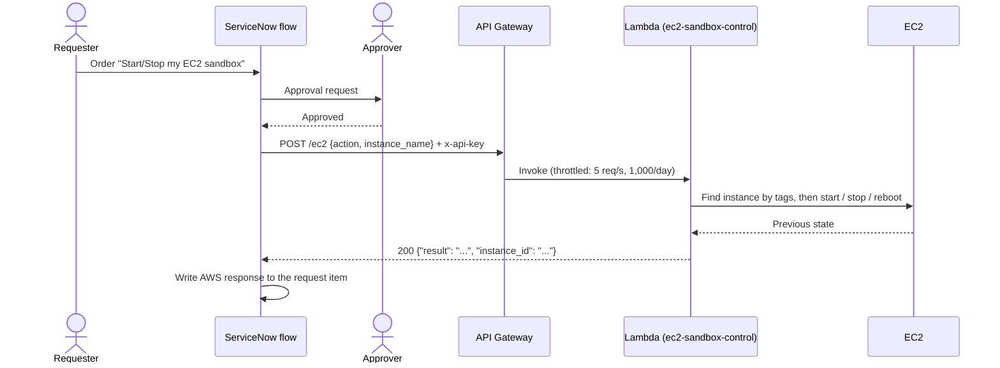

---

## Walkthrough

### 1. AWS alarm → ServiceNow incident

A CloudWatch alarm watches the instance's `StatusCheckFailed_Instance` metric. State changes go to an SNS topic, which triggers `sn-incident-creator`.

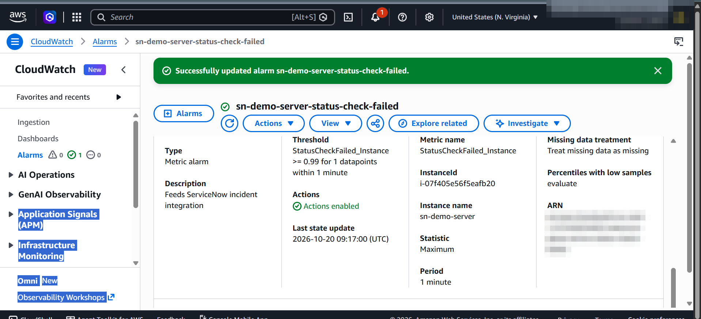
*The alarm: Maximum of `StatusCheckFailed_Instance` over 1 minute, with actions enabled. (Account details redacted.)*

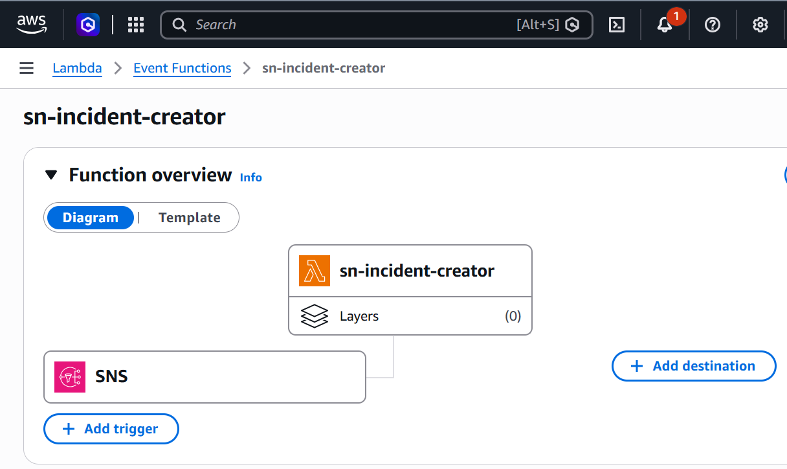
*`sn-incident-creator` with its SNS trigger.*

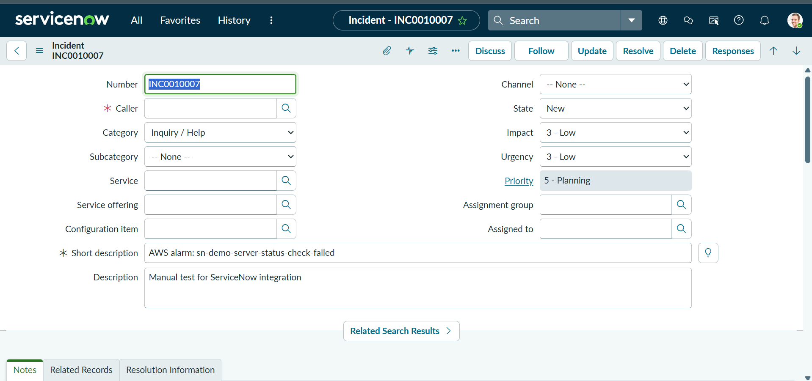
*The incident created by the integration. This capture predates the CI-link feature, so Configuration item is still empty (see flow 4).*

**De-duplication.** The Lambda sets `correlation_id = aws-cw-<alarm name>` and looks for an *active* incident with that ID before it creates anything:

```python
q = urllib.parse.quote(f"correlation_id={corr_id}^active=true")
res = sn_request("GET", f"/api/now/table/incident?sysparm_query={q}&sysparm_limit=1")
```

If one exists it gets a work note; otherwise a new incident is created.

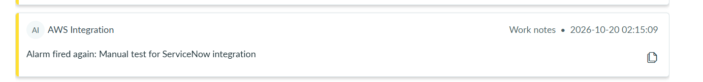
*Second firing: a work note on the existing incident, not a second incident.*

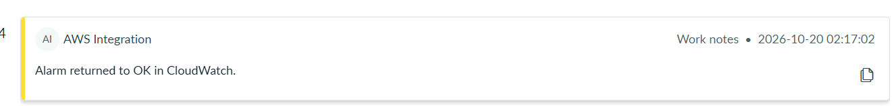
*Recovery: the alarm returning to OK adds a note.*

### 2. Self-service: catalog → approval → AWS

Users order **Start/Stop my EC2 sandbox**. A Workflow Studio flow collects the catalog variables, asks for approval, and on approval calls a reusable custom action that POSTs to API Gateway.

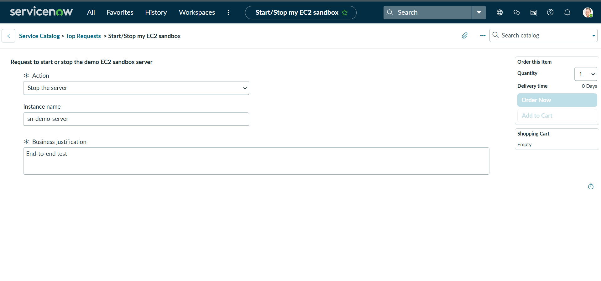
*The catalog item: a Select Box (start/stop), an instance name and a mandatory justification.*

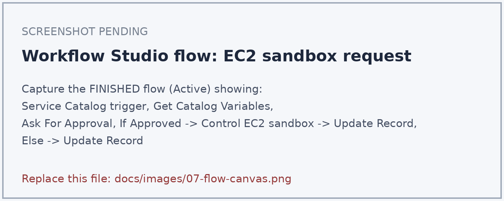
*Flow: Service Catalog trigger → Get Catalog Variables → Ask For Approval → If approved: update record, call `Control EC2 sandbox`, write AWS response → Else: reject.*

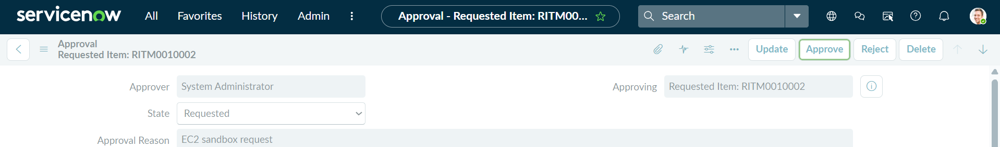
*The approval record for the request item.*

**The AWS side is protected at the edge.** API Gateway requires an API key and enforces a usage plan.

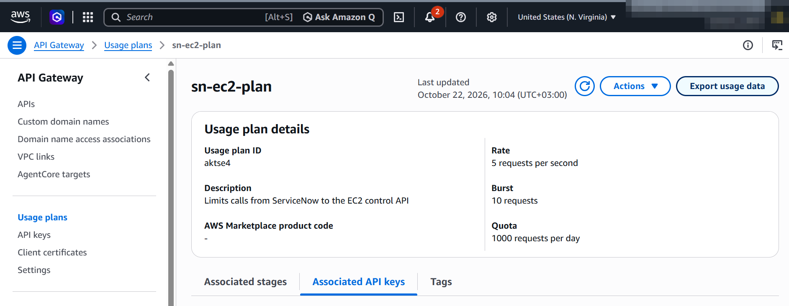
*Usage plan `sn-ec2-plan`: 5 requests/second, burst 10, 1,000 requests/day. (Account details redacted.)*

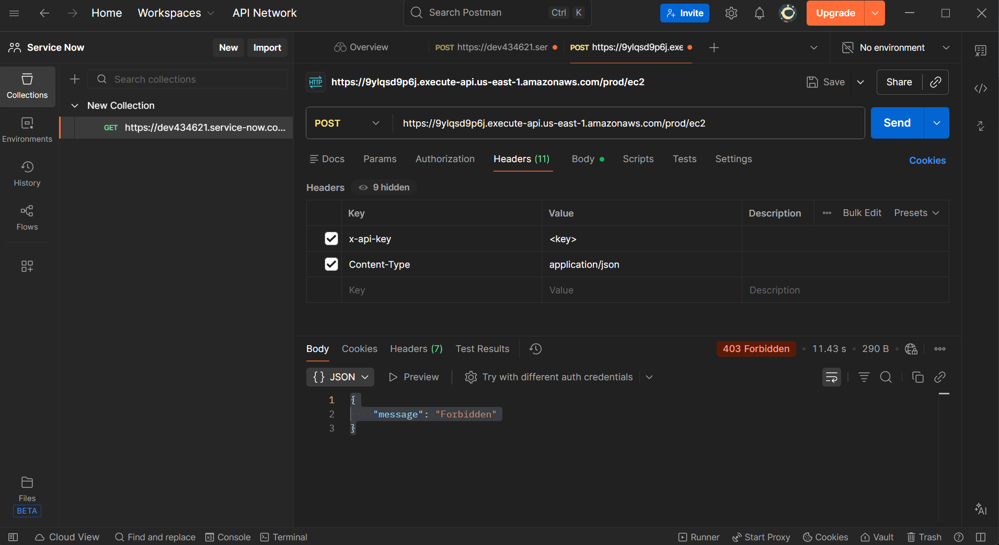
*Without the `x-api-key` header the API answers `403 Forbidden`.*

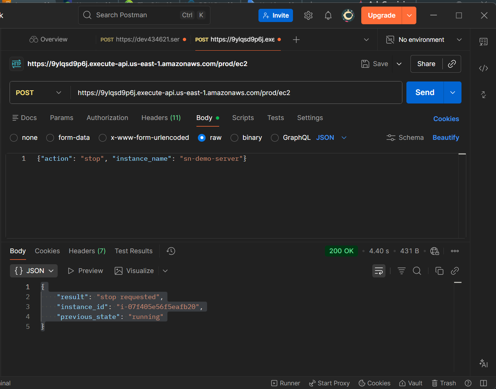
*With the key: `200`, `"result": "stop requested"`, plus the instance ID and its previous state.*

**ServiceNow side: the `Control EC2 sandbox` custom action.** One REST step, two inputs, two outputs. It is reused by the flow *and* by the remediation button.

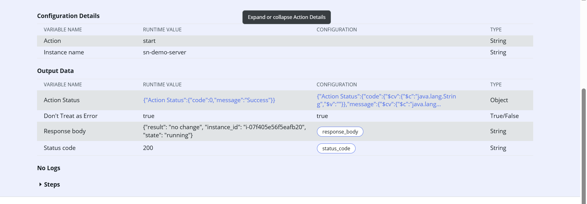
*Action test run: status `200`, response body from the Lambda.*

**End-to-end result.** The AWS response comes back onto the request item, and the EC2 console agrees.

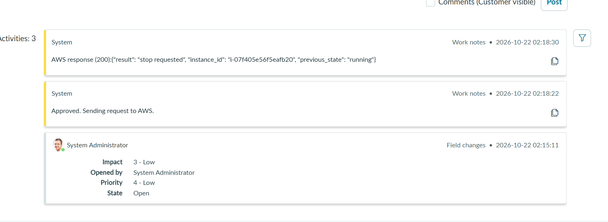
*Request item work notes: approval, then `AWS response (200): ... "stop requested", "previous_state": "running"`.*

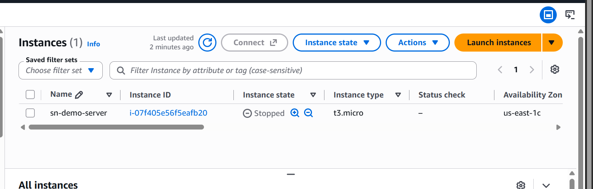
*EC2 console: the instance is **Stopped**.*

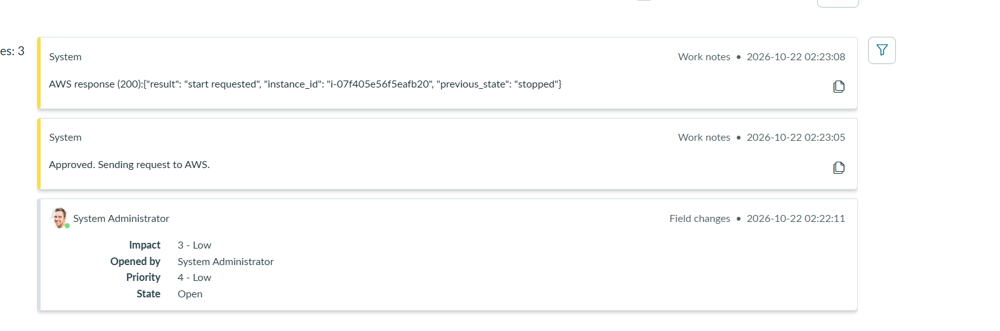
*The reverse: `"start requested", "previous_state": "stopped"`.*

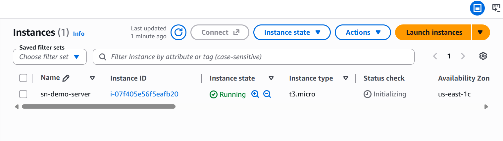
*EC2 console: **Running**, status checks initialising.*

### 3. One-click remediation from an incident

On incidents raised by the integration, a **Restart AWS server** button appears. It is a UI Action that runs the same custom action with `action = reboot`, then writes the result to the incident.

The button only shows when the incident is active **and** its correlation ID starts with `aws-cw-`:

```js
current.correlation_id.toString().indexOf('aws-cw-') == 0 && current.active == true
```

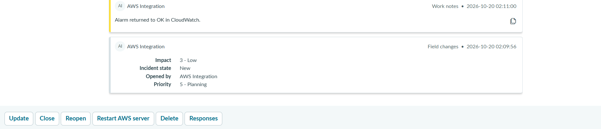
*The **Restart AWS server** button on an alarm incident.*

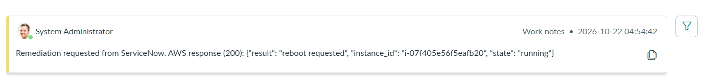
*Result: `AWS response (200): {"result": "reboot requested", ...}`.*

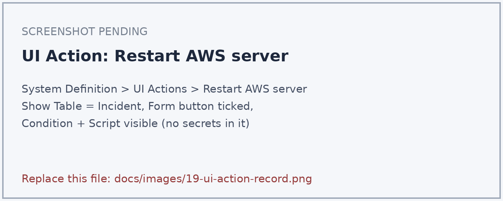
*The UI Action definition. Script: [`servicenow/ui-action-restart-aws-server.js`](servicenow/ui-action-restart-aws-server.js).*

### 4. CMDB sync and incident-to-CI link

`ec2-cmdb-sync` reads the tagged instance and upserts it into `cmdb_ci_ec2_instance`, keyed on `object_id`. Because the CI `state` field is a choice list, AWS states are mapped to its values:

| AWS state | ServiceNow `state` |
|---|---|
| `running` | `on` |
| `stopped` | `off` |
| `pending` | `starting` |
| `stopping` | `stopping` |
| `shutting-down` | `terminating` |
| `terminated` | `terminated` |

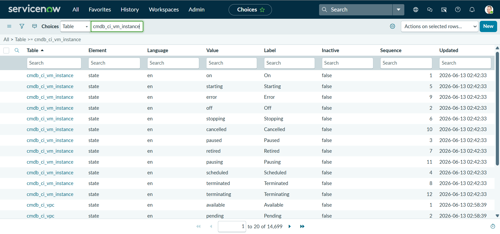
*Valid `state` choice values for `cmdb_ci_vm_instance` (the parent of the EC2 CI table), read from `sys_choice`.*

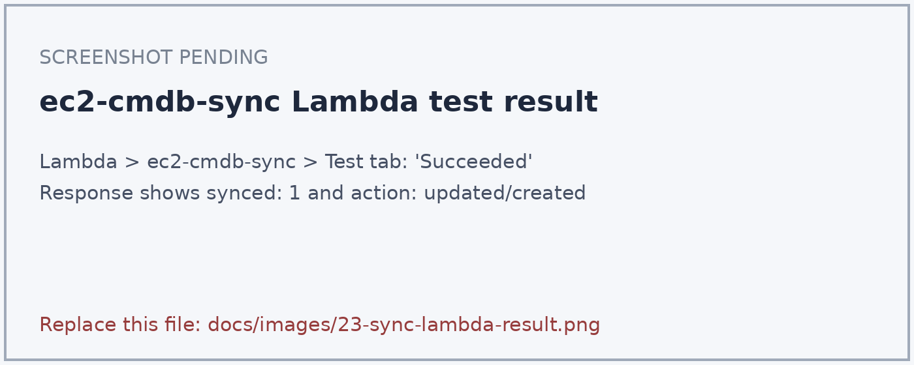
*Lambda result: one instance synced.*

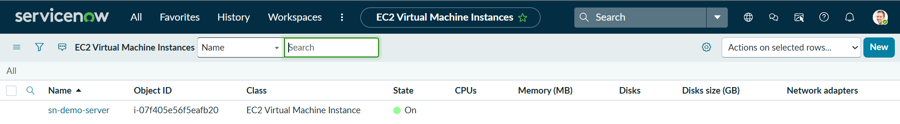
*The EC2 CI with **State: On**.*

The incident Lambda then looks the CI up by instance ID (taken from the alarm's `InstanceId` dimension) and sets the incident's `cmdb_ci`:

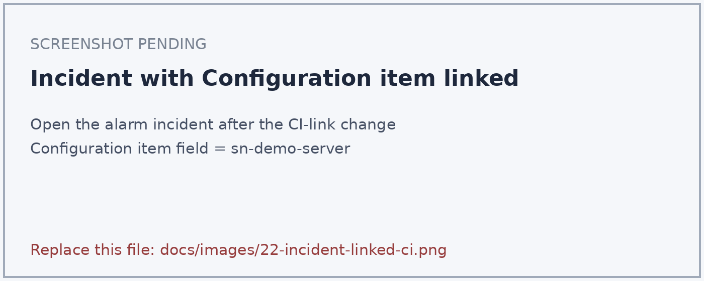
*The incident's Configuration item points at the real server record, which closes the loop: alarm → incident → CI → remediation.*

---

## Design decisions

1. **Idempotent incident creation.** A deterministic `correlation_id` plus an "is there already an active one?" check means a flapping alarm or a retried invocation cannot flood the queue.
2. **Verify before failing.** When ServiceNow timed out on a create, the record had often been saved anyway. On a write error the Lambda re-queries before raising, so a timeout does not become a duplicate.
3. **Enrichment is best effort.** Linking the CI is a separate `PATCH` inside `try/except`. A CMDB problem can never stop an incident from being created.
4. **Small blast radius.** The control Lambda only touches instances tagged `Project=sn-aws-demo`, validates `action` against an allow-list, and refuses to reboot an instance that is not running (`409`). The IAM policy repeats the tag condition, so the limit holds even if the code changes.
5. **Human in the loop.** Catalog changes need approval, and remediation is a button, not an automatic action. Auto-remediation is a roadmap item once guardrails exist.
6. **One reusable building block.** `Control EC2 sandbox` is a single custom action used by both the flow and the UI Action, so there is one place to change the API contract.
7. **Normalise at the boundary.** AWS and ServiceNow describe state differently. The mapping lives in one dictionary in the sync Lambda, and an unknown AWS state is sent empty instead of failing the run.
8. **Defaults over fields on a constrained platform.** Setting `urgency`/`impact` on insert exceeded the PDI's transaction limit, so I left them out and let the instance defaults apply (details in the troubleshooting log).

---

## Security

| Control | Implementation |
|---|---|
| Secrets | ServiceNow credentials live in **Secrets Manager**, not in code or environment variables. The Lambda role can read only that one secret. |
| Least privilege | `ec2:Start/Stop/RebootInstances` is allowed only where `aws:ResourceTag/Project = sn-aws-demo`. Describe is read-only. |
| API edge | API key required, plus a usage plan (5 req/s, burst 10, 1,000/day). Requests without a key get `403`. |
| ServiceNow identity | A dedicated integration user with only `rest_service` and `itil`, not an admin account. |
| Change control | Catalog requests require approval. The remediation button is only visible on open, AWS-originated incidents. |
| Cost control | One small instance, an AWS Budget alert, and a documented cleanup step. |
| Secret hygiene | Keys and passwords are rotated before screenshots or recordings are shared. Policies in this repo use `<ACCOUNT_ID>` placeholders. |

Known gaps are listed under [Limitations and roadmap](#limitations-and-roadmap).

---

## Troubleshooting log

The failures were useful. Each one changed the design.

| Symptom | Cause | Fix |
|---|---|---|
| `500 Transaction cancelled: maximum execution time exceeded` when creating an incident (took 1 m 1.8 s), yet the incident **was** created | Sending `urgency` and `impact` on insert triggered a priority/SLA rule chain that blew the PDI's transaction limit. Isolated by bisecting the request: a minimal body and a `correlation_id`-only body succeeded in a few seconds. | Omit those fields; add the **verify-before-failing** and **de-duplication** logic so a timeout never creates duplicates. |
| `404 Expected 1 matching instance, found 0` from the control Lambda | The tag filter returned nothing. Isolated by running the same `describe-instances` filter in CloudShell, checking the instance's tags, and scanning every region for the instance ID. | Re-checked the exact tag keys and values (matching is case- and whitespace-sensitive); the lookup then returned the instance. |
| API Gateway `Missing Authentication Token` | Misleading wording: the URL did not match a deployed route (wrong stage or resource path). | Use `<invoke-url>/ec2` where the invoke URL already ends in `/prod`. The *expected* no-key response is `403 Forbidden`. |
| Custom action returned `400 Need action (start\|stop) and instance_name` | The request body contained the literal text `[Action]` instead of data pills, so the Lambda received a string, not `start`. Found by reading the **Request Body** in the execution details. | Insert the Action and Instance name as **data pills** inside the quoted JSON. |
| CI `state` stayed empty after a successful sync | `state` is a choice field; `running`/`stopped` are not valid choices, so ServiceNow ignored them. | Read the valid values from `sys_choice` and add `STATE_MAP` (`running` → `on`, and so on). |
| Slow ServiceNow responses made Lambdas time out | The PDI can take tens of seconds (one flow run took 78 s). | HTTP timeout 65 s, function timeouts 2–5 minutes, and idempotent writes so retries are safe. |

<details>
<summary>Screenshots for the two main incidents</summary>

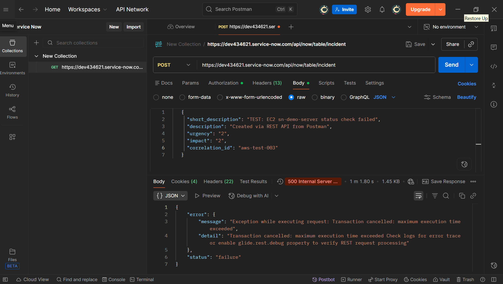
*The 500 on incident creation.*

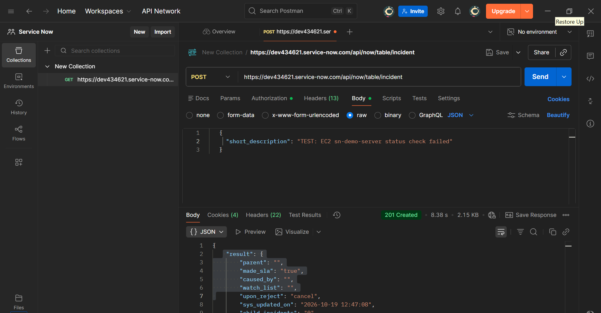
*A minimal body succeeds with `201 Created`.*

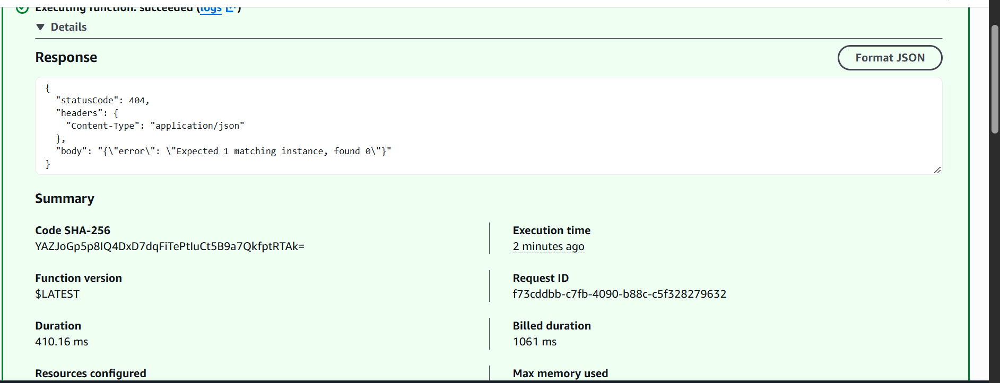
*The control Lambda's own `404` while the tags were being diagnosed.*

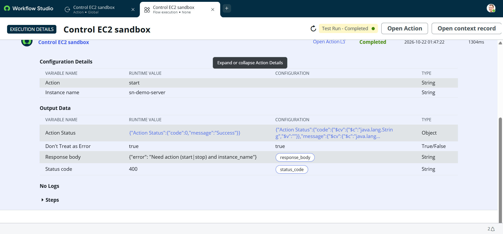
*Custom action test: `400` because the body held placeholder text.*

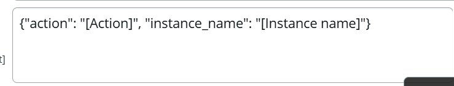
*Wrong: `[Action]` typed as plain text.*

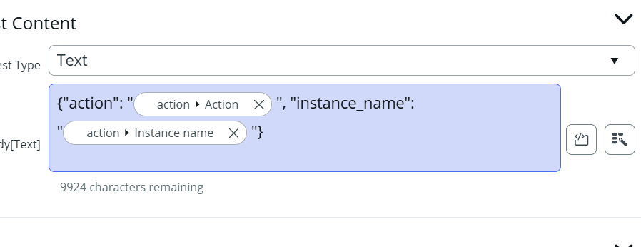
*Right: real data pills inside the quotes.*

</details>

---

## Verified behaviour

| Test | Expected | Result |
|---|---|---|
| Alarm → ALARM | One incident `AWS alarm: <alarm name>` | Pass ([evidence](docs/images/02-incident-from-alarm.png)) |
| Alarm fires again | Work note on the same incident, no second incident | Pass ([evidence](docs/images/03-dedup-work-note.png)) |
| Alarm → OK | Recovery note | Pass ([evidence](docs/images/04-recovery-work-note.png)) |
| API call without key | `403 Forbidden` | Pass ([evidence](docs/images/14-postman-403-no-key.png)) |
| API call with key, `stop` | `200`, `stop requested` | Pass ([evidence](docs/images/15-postman-200-stop.png)) |
| Catalog order → approve → Stop | Request item note with AWS response; EC2 **Stopped** | Pass ([evidence](docs/images/09-ritm-stop-response.png), [EC2](docs/images/10-ec2-stopped.png)) |
| Catalog order → approve → Start | Request item note with AWS response; EC2 **Running** | Pass ([evidence](docs/images/11-ritm-start-response.png), [EC2](docs/images/12-ec2-running.png)) |
| Restart button on alarm incident | Incident note `reboot requested` | Pass ([evidence](docs/images/18-remediation-work-note.png)) |
| CMDB sync | EC2 CI exists with State **On**; re-running updates, does not duplicate | Pass ([evidence](docs/images/21-ci-list-state-on.png)) |
| Alarm incident after CI link | Configuration item = the EC2 CI | Pass ([evidence](docs/images/22-incident-linked-ci.png)) |

---

## Repository layout

```
.
├── README.md
├── docs/
│   ├── SETUP.md                       # step-by-step build guide
│   └── images/                        # screenshots used above
├── lambda/
│   ├── sn_incident_creator/           # SNS -> ServiceNow incident (dedupe, recovery, CI link)
│   ├── ec2_sandbox_control/           # API Gateway -> EC2 start / stop / reboot
│   └── ec2_cmdb_sync/                 # EC2 -> CMDB upsert with state mapping
├── iam/                               # least-privilege policies (placeholders for account ID)
├── servicenow/
│   └── ui-action-restart-aws-server.js
└── tests/events/                      # sample events for the Lambda Test tab
```

---

## Reproduce it

You need a free ServiceNow PDI, an AWS account and about a day. The full procedure, with names, settings and checks for each step, is in **[docs/SETUP.md](docs/SETUP.md)**.

Quick check once it is built:

```bash
# 1. raise an alarm incident
aws cloudwatch set-alarm-state --alarm-name sn-demo-server-status-check-failed \
  --state-value ALARM --state-reason "demo"

# 2. fire it again: the same incident gets a note, no second incident
# 3. open the incident and click "Restart AWS server"
# 4. return the alarm to normal
aws cloudwatch set-alarm-state --alarm-name sn-demo-server-status-check-failed \
  --state-value OK --state-reason "demo finished"
```

---

## Limitations and roadmap

Honest about what this is and what production would need:

| Today | Next step |
|---|---|
| ServiceNow API calls from AWS use **Basic auth** with a least-privilege integration user | **OAuth 2.0** (client credentials) |
| The AWS API key sits in the REST step's header | **Connection & Credential Alias** in ServiceNow; add IAM/SigV4 or a Lambda authorizer on API Gateway |
| Built by hand in the consoles | **Infrastructure as code** (AWS SAM or Terraform) and an exported ServiceNow update set |
| The remediation button hard-codes the instance name | Read the instance from the incident's linked CI |
| CMDB sync is a poll (on demand or hourly) | **Event-driven** updates from EC2 state-change events via EventBridge |
| Hand-rolled CMDB writes through the Table API | ServiceNow **IRE** (Identification and Reconciliation) or the licensed **Service Graph Connector for AWS**, with pagination, for multi-account scale |
| No automated tests | Unit tests for the three Lambdas with mocked `boto3` and HTTP |
| One region, one account, one instance | Multi-region and multi-account, tag-driven |
| `urgency`/`impact` omitted because of PDI limits | Set priority from alarm severity once running on a properly sized instance |
| Failed invocations are only logged | Dead-letter queue, structured logs and a CloudWatch alarm on Lambda errors |

### Cost and cleanup

One `t3.micro`, a handful of Lambda invocations and an API Gateway endpoint cost very little, but set an AWS Budget alert anyway. When finished: stop or terminate the instance, delete the EventBridge rule and API key, and rotate any credential that appeared in a screenshot.

---

## Author

**Sharon Wainaina**: systems and cloud engineer with AWS and OCI certifications. [LinkedIn](https://www.linkedin.com/in/sharon-wainaina-556206395/)

Released under the [MIT License](LICENSE).
